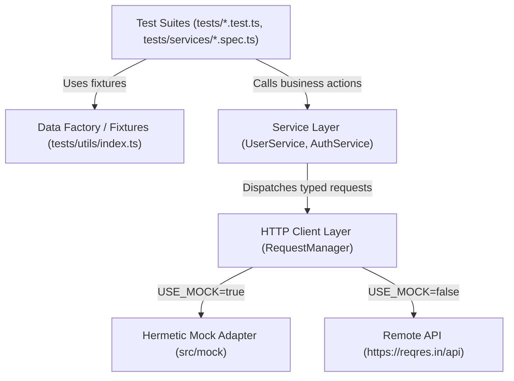

# REST API Automation Testing Framework

[](https://www.typescriptlang.org/)
[](https://jestjs.io/)
[](https://axios-http.com/)
[](https://prettier.io/)
[](<>)
[](LICENSE)

An enterprise-ready, strongly-typed REST API automated testing framework built with **TypeScript**, **Jest**, and **Axios**, leveraging the **Service Object Model (SOM)** and **Data Factory** design patterns.

Targeted against the [ReqRes](https://reqres.in) REST API with support for both live endpoints and hermetic mock execution.

---

## Table of Contents

- [Features](#features)
- [Architecture & Design Patterns](#architecture--design-patterns)
- [Project Structure](#project-structure)
- [Prerequisites](#prerequisites)
- [Getting Started](#getting-started)
- [Environment Configuration](#environment-configuration)
- [Available Scripts](#available-scripts)
- [Test Suites & Coverage](#test-suites--coverage)
- [Handling 3rd-Party Rate Limits](#handling-3rd-party-rate-limits)
- [Writing New Tests & Services](#writing-new-tests--services)
- [CI/CD Integration](#cicd-integration)

---

## Features

- **Strict TypeScript**: Full end-to-end type safety, modern ES2022 target, strict null checks, and path alias mapping (`@src/*`, `@tests/*`).
- **Service Object Model (SOM)**: Separation of concerns between HTTP transport, API service endpoints, data generation, and test assertions.
- **Unified HTTP Client (`RequestManager`)**: Centralized Axios instance with configurable base URLs, timeouts, non-throwing HTTP status validation (allowing direct assertions on 4xx/5xx responses), and socket connection cleanup.
- **Dynamic Data Generation**: Realistic, randomized mock data generators powered by [Chance.js](https://chancejs.com/).
- **Dual Execution Modes**:
  - **Hermetic Mock Mode** (`npm test`): Blazing-fast (<3s), offline-capable, and immune to 3rd-party rate limits.
  - **Live Integration Mode** (`npm run test:live`): Real network validation against live API backends.
- **Backwards Compatibility**: Seamless compatibility with legacy test imports and runner configs (`jest.unit.json`, `requestsManager.ts`, `url.config.ts`).
- **Code Quality & Tooling**: Configured with Prettier, clean scripts, strict TypeScript typechecking, and comprehensive Jest coverage reporting.

---

## Architecture & Design Patterns



### Layer Responsibilities

1. **Config Layer (`src/config/`)**:
   Reads environment variables via `dotenv` and exposes strongly-typed configuration settings (`baseUrl`, `timeout`, `apiKey`, endpoints).
2. **Types & Enums Layer (`src/types/`)**:
   Declares domain models (`User`, `LoginPayload`, `PaginatedResponse<T>`) and enums (`StatusCode`, `UserData`, `PageNumber`).
3. **HTTP Client Layer (`src/client/`)**:
   Wraps Axios with automatic response normalization (`statusText`), open socket prevention (`keepAlive: false`), and flexible error handling.
4. **Service Layer (`src/services/`)**:
   Exposes high-level domain operations (`UserService`, `AuthService`) encapsulating endpoint URLs and payload contracts.
5. **Mock Layer (`src/mock/`)**:
   Provides high-fidelity ReqRes contract stubs for hermetic testing in CI or restricted environments.
6. **Test Utilities (`tests/utils/`)**:
   Data generation factories using `Chance` to produce valid payloads on demand.

---

## Project Structure

```text
Jest-Api-test/
├── src/
│   ├── client/
│   │   ├── RequestManager.ts     # Core Axios HTTP client wrapper
│   │   └── index.ts              # Client exports
│   ├── config/
│   │   └── env.ts                # Environment & endpoint configuration
│   ├── mock/
│   │   ├── mockData.ts           # Mock dataset contracts
│   │   └── setupMock.ts          # Axios mock adapter bindings
│   ├── services/
│   │   ├── AuthService.ts        # Authentication service (login, register)
│   │   ├── UserService.ts        # User service (CRUD, pagination, unknown resources)
│   │   └── index.ts              # Services exports
│   ├── types/
│   │   ├── enums.ts              # HTTP status codes & constants
│   │   ├── models.ts             # Strongly-typed payloads & response interfaces
│   │   └── index.ts              # Type definitions export
│   └── index.ts                  # Public package entry point
├── tests/
│   ├── apis/                     # Backwards-compatible legacy client wrappers
│   │   ├── deleteUser.ts
│   │   ├── getUser.ts
│   │   ├── loginUser.ts
│   │   ├── registerUser.ts
│   │   └── updateUser.ts
│   ├── services/                 # Modern Service Object Model test suites
│   │   ├── authService.spec.ts   # AuthService positive & negative scenarios
│   │   └── userService.spec.ts   # UserService CRUD & pagination tests
│   ├── utils/
│   │   └── index.ts              # Data factories (Chance.js)
│   ├── deleteReq.test.ts         # DELETE user test suite
│   ├── getReq.test.ts            # GET users & resources test suite
│   ├── loginReq.test.ts          # POST login test suite
│   ├── postReq.test.ts           # POST create user test suite
│   └── putReq.test.ts            # PUT update user test suite
├── .env.example                  # Environment configuration template
├── .gitignore                    # Git ignore file
├── .prettierrc                   # Prettier code formatting rules
├── jest.config.ts                # Modern Jest configuration
├── jest.unit.json                # Backwards-compatible Jest config
├── package.json                  # Dependencies, scripts, and package metadata
├── requestsManager.ts            # Backwards-compatible root export
├── tsconfig.json                 # TypeScript compiler configuration
├── url.config.ts                 # Backwards-compatible endpoints export
└── README.md                     # Project documentation
```

---

## Prerequisites

- **Node.js**: `v18.x` or higher (tested on Node `v24.x`)
- **npm**: `v9.x` or higher (tested on npm `v11.x`)

---

## Getting Started

1. **Clone the repository**:

   ```bash
   git clone <repo-url>
   cd Jest-Api-test
   ```

2. **Install dependencies**:

   ```bash
   npm install
   ```

3. **Configure environment variables**:

   ```bash
   cp .env.example .env
   ```

4. **Run the test suite**:
   ```bash
   npm test
   ```

---

## Environment Configuration

Create a `.env` file in the project root to customize execution settings:

| Variable          | Description                                       | Default                 |
| :---------------- | :------------------------------------------------ | :---------------------- |
| `API_BASE_URL`    | Base URL of the target REST API                   | `https://reqres.in/api` |
| `REQUEST_TIMEOUT` | Request timeout in milliseconds                   | `15000`                 |
| `USE_MOCK`        | Enable (`true`) or disable (`false`) mock adapter | `true`                  |
| `REQRES_API_KEY`  | Optional ReqRes API key for higher rate limits    | _None_                  |

---

## Available Scripts

| Command                 | Description                                                                    |
| :---------------------- | :----------------------------------------------------------------------------- |
| `npm test`              | Runs all test suites using the hermetic mock adapter (fast & rate-limit safe)  |
| `npm run test:live`     | Runs all test suites against the live API backend                              |
| `npm run test:watch`    | Runs Jest in interactive watch mode for TDD                                    |
| `npm run test:coverage` | Generates a comprehensive code coverage report in the terminal and `coverage/` |
| `npm run test:ci`       | Executes tests with CI flags (`--ci`, coverage collection, limited workers)    |
| `npm run build`         | Compiles the TypeScript codebase into the `dist/` directory                    |
| `npm run clean`         | Cleans up the `dist/` and `coverage/` directories                              |
| `npm run typecheck`     | Runs TypeScript type checking without emitting files                           |
| `npm run format`        | Automatically formats all TypeScript and JSON files with Prettier              |
| `npm run format:check`  | Verifies code formatting compliance                                            |

---

## Test Suites & Coverage

The framework includes comprehensive test coverage for all HTTP operations:

```
PASS tests/services/authService.spec.ts (positive/negative login & register)
PASS tests/services/userService.spec.ts (pagination, single user, 404, CRUD, partial updates)
PASS tests/getReq.test.ts (paginated users, resources, single entity query)
PASS tests/postReq.test.ts (resource creation and schema verification)
PASS tests/putReq.test.ts (entity update and ISO timestamp validation)
PASS tests/deleteReq.test.ts (HTTP 204 No Content validation)
PASS tests/loginReq.test.ts (token acquisition and missing password handling)

Coverage Summary:
Statements   : 93.02%
Lines        : 92.91%
Functions    : 89.18%
```

---

## Handling 3rd-Party Rate Limits

ReqRes enforces an **anonymous limit of 40 requests/day per IP**. When this limit is exceeded, the server responds with `HTTP 429 Too Many Requests`.

To solve this in enterprise pipelines, this framework supports:

1. **Hermetic Mock Mode (Default)**: `npm test` runs with an in-memory mock adapter reproducing ReqRes behavior. This eliminates external network flakiness and allows tests to run instantly in CI.
2. **Live Mode with API Key**: When running against live servers via `npm run test:live`, set `REQRES_API_KEY=<your-key>` in your `.env` to unlock higher daily quotas.

---

## Writing New Tests & Services

### 1. Creating a New Service

Create a new service file under `src/services/`:

```typescript
import { RequestManager } from "../client/RequestManager";
import { AxiosResponse } from "axios";

export class OrderService {
  private readonly client: RequestManager;

  constructor(client?: RequestManager) {
    this.client = client || new RequestManager();
  }

  async getOrder(orderId: number): Promise<AxiosResponse<any>> {
    return this.client.get(`/orders/${orderId}`);
  }
}
```

### 2. Adding a Test Suite

Add a new test file under `tests/`:

```typescript
import { OrderService } from "@src/services/OrderService";
import { StatusCode } from "@src/types/enums";

describe("OrderService Tests", () => {
  const orderService = new OrderService();

  it("should retrieve order details", async () => {
    const response = await orderService.getOrder(1);
    expect(response.status).toBe(StatusCode.OK);
    expect(response.data).toHaveProperty("id", 1);
  });
});
```

---

## CI/CD Integration

Example GitHub Actions workflow (`.github/workflows/test.yml`):

```yaml
name: Test Suite

on:
  push:
    branches: [main]
  pull_request:
    branches: [main]

jobs:
  test:
    runs-on: ubuntu-latest

    steps:
      - name: Checkout code
        uses: actions/checkout@v4

      - name: Setup Node.js
        uses: actions/setup-node@v4
        with:
          node-version: 20
          cache: "npm"

      - name: Install dependencies
        run: npm ci

      - name: Run TypeScript typecheck
        run: npm run typecheck

      - name: Run tests with coverage
        run: npm run test:ci

      - name: Build project
        run: npm run build
```

---

## License

This project is licensed under the [ISC License](LICENSE).
